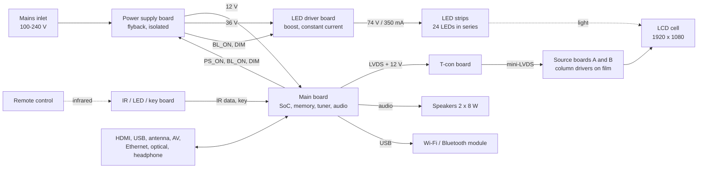
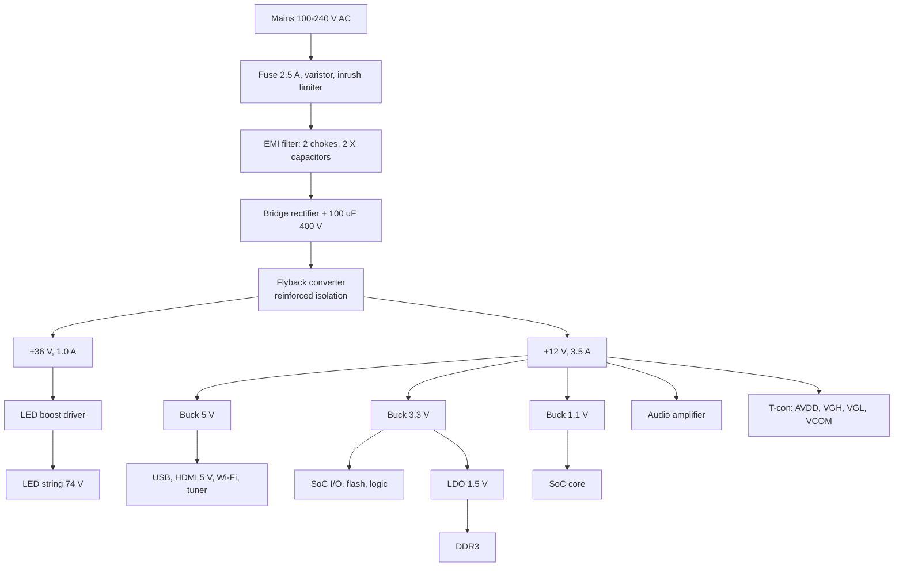

# Electrical design: 32 inch LED television

Generated by `python electrical.py` from `config.py` and `tv/board_data.py`.
Do not edit by hand; change the source and regenerate.

**Level of detail.** This is a system-level reference design: what the blocks
are, how they connect, what power they need and where the parts sit on each
board. It contains no circuit schematics and no PCB layouts. Read section 10
before using any of it.

## 1. Block diagram

## 2. Power tree

## 3. Power budget

### 12 V rail

| Load | Power at the load | Power from the 12 V rail | Note |
|---|---|---|---|
| SoC, DDR3 and eMMC | 5.00 W | 5.68 W | 1.1 V core, 1.5 V memory, 3.3 V I/O |
| Tuner, Wi-Fi/Bluetooth, Ethernet, logic | 2.50 W | 2.84 W | 3.3 V and 5 V |
| USB ports, 2 x 500 mA at 5 V | 5.00 W | 5.68 W | both ports fully loaded |
| HDMI +5 V outputs, 2 x 55 mA | 0.55 W | 0.62 W |  |
| Audio amplifier | 8.00 W | 9.41 W | half of 2 x 8 W rated output, at 85 percent efficiency |
| T-con and LCD panel logic | 5.00 W | 5.00 W | 12 V direct to the T-con |
| IR receiver, standby LED, standby logic | 0.20 W | 0.20 W |  |
| **Total** |  | **29.4 W = 2.45 A** | rated 3.5 A, 30% spare |

Loads fed through an on-board buck converter are divided by
88% converter efficiency. The audio line is 8 W of
output, which is half the amplifier's 2 x 8 W rating: music and speech average
well under full power. At full sine-wave output on both channels the 12 V rail
would be overloaded, so the amplifier's power limit must be set accordingly.

### 36 V rail (backlight)

| Item | Value |
|---|---|
| LEDs | 24 (3 strips of 8), all in series |
| String voltage | 24 x 3.1 V = 74.4 V |
| String current | 350 mA, constant |
| LED power | 26.0 W |
| Driver input | 28.3 W at 92% = 0.79 A at 36 V |
| Rail rating | 1.0 A, 21% spare |
| Boost duty cycle | 52% at full brightness |

### Mains input

| Item | Value |
|---|---|
| Total DC output | 57.7 W |
| Supply efficiency assumed | 87% |
| Mains input power | 66.4 W |
| Heat in the power supply | 8.6 W |
| Highest input current | 1.21 A at 100 V, power factor 0.55 |
| Fuse | T2.5 A, 2.1 times the highest input current |
| Standby target | under 0.5 W |

Input power is under 75 W, so no power-factor-correction
stage is fitted. That threshold comes from the harmonic-current limits for this
class of equipment (EN 61000-3-2 class D).

## 4. The boards

| Board | Size | Layers | Parts placed | Job |
|---|---|---|---|---|
| Main board | 170 x 190 mm | 4 | 79 | Runs the TV: decodes video, drives the panel link, audio, tuner, all ports |
| Power supply board | 170 x 130 mm | 1 | 31 | Turns mains into isolated 12 V and 36 V |
| T-con board | 130 x 45 mm | 4 | 12 | Converts LVDS video into the timing and column data the LCD needs; makes the panel's bias voltages |
| LED driver board | 90 x 50 mm | 2 | 10 | Boosts 36 V to the LED string voltage and holds the current constant |
| Wi-Fi / Bluetooth module | 40 x 26 mm | 2 | 3 | 2.4 / 5 GHz Wi-Fi and Bluetooth radio, on USB |
| IR / LED / key board | 54 x 8 mm | 1 | 5 | Infrared receiver, standby LED and the one control button |

Two more boards belong to the panel: source boards A and B, each
330 x 18 mm, bonded to the bottom edge
of the glass through 4 chip-on-film column drivers each. Row
drivers are built into the glass (gate-on-array), so there are no gate boards.

## 5. Main board in detail

170 x 190 mm, 4 layers
(signal, ground, power, signal), 79 parts placed.

### Functional blocks

| Block | Parts | What it does |
|---|---|---|
| Processor | U1 under heatsink HS1 | Quad-core ARM SoC with video decoder, HDMI receivers, LVDS transmitter, USB and Ethernet controllers |
| Memory | U2, U3 | 2 x 512 MB DDR3, routed as a matched-length point-to-point bus |
| Storage | U4, U5 | 8 GB eMMC for the operating system; SPI flash for the boot loader |
| Clock | Y1 | 24 MHz crystal |
| Tuner | TU1, J10 | Silicon tuner and demodulator under a shield can, next to the RF input |
| Audio | U7, L1-L4, C1, C2 | Class-D amplifier, 2 x 8 W, with an LC output filter per speaker wire |
| Power | U8-U10, L5-L7, U14 | Three buck converters and one linear regulator (table below) |
| Port protection | U11, U12, U13 | USB current-limit switch; ESD arrays on both HDMI inputs |

### On-board supply rails

| Rail | Made by | Feeds |
|---|---|---|
| +12V | PSU | Audio amplifier, T-con / panel, inputs of all converters |
| +5V | U8 buck, 3 A | USB ports, HDMI +5 V, Wi-Fi module, tuner |
| +3V3 | U9 buck, 2 A | SoC I/O, flash, Ethernet, logic |
| +1V1 | U10 buck, 3 A | SoC core |
| +1V5 | U14 linear regulator from 3.3 V | DDR3 memory |
| +3V3_STBY | Standby regulator from +12V_STBY | IR receiver, standby logic, key input |

Power-up order: +3V3_STBY is always present. When the standby logic raises
PS_ON, +12V comes up, then 3.3 V, 1.5 V, 1.1 V, then reset is released. The
panel supply (VDD_PANEL) is switched on before LVDS starts, and the backlight
(BL_ON) last, so the screen never shows an unpowered or unsynchronised panel.

### External ports (top to bottom on the side connector panel)

| Ref | Port |
|---|---|
| J1 | HDMI 2.0 input 1 (type A receptacle) |
| J2 | HDMI 2.0 input 2 with ARC (type A receptacle) |
| J3 | USB 2.0 host 1 (type A receptacle) |
| J4 | USB 2.0 host 2 (type A receptacle) |
| J5 | Optical digital audio out (TOSLINK) |
| J6 | Headphone out, 3.5 mm stereo jack |
| J7 | Composite video in (RCA, yellow) |
| J8 | Audio in left (RCA, white) |
| J9 | Audio in right (RCA, red) |
| J10 | Antenna / cable RF in (IEC coaxial) |
| J11 | Ethernet 10/100 (RJ45 with magnetics) |

### Layout notes

- Ports sit on one edge so they line up with the recess in the rear cover.
- The RF input and tuner are at the opposite end of that edge from HDMI and
  USB, to keep the tuner away from fast digital signals.
- The buck converters and the audio amplifier are on the edge nearest the
  power connector, so high currents do not cross the processor area.
- Decoupling capacitors ring the SoC and the memory.

## 6. Internal connections

| From | Ref | To | Ref | Cable | Carries |
|---|---|---|---|---|---|
| Mains inlet | - | PSU | CN1 | 2-core mains lead | Live, neutral (class II: no earth) |
| PSU | CN2 | Main board | CN1 | 12-way wire harness | 12 V, ground, standby and backlight control |
| PSU | CN3 | LED driver | CN1 | 6-way wire harness | 36 V, ground, enable, dimming |
| LED driver | CN2 | LED strips | - | 4-way wire harness | LED string + and -, through the chassis |
| Main board | CN2 | T-con | CN1 | 51-way 0.5 mm FFC | Dual-link LVDS video and panel power |
| T-con | CN2 | Source board A | - | 60-way 0.5 mm FFC | mini-LVDS column data, gamma, power |
| T-con | CN3 | Source board B | - | 60-way 0.5 mm FFC | mini-LVDS column data, gamma, power |
| Main board | CN3 | Speakers | - | 2 x twin lead | Left and right speaker outputs |
| Main board | CN4 | IR / LED / key board | CN1 | 6-way wire harness | IR data, LED, key, 3.3 V standby |
| Main board | CN5 | Wi-Fi / Bluetooth module | CN1 | 4-way wire harness | USB 2.0 |

## 7. Connector pinouts

Representative pin assignments. A real design would follow the chosen panel's
and modules' datasheets.

### PSU CN2 to main board CN1 (12-pin)

| Pin | Signal | Notes |
|---|---|---|
| 1-3 | +12V | Main supply, 3.5 A total |
| 4-7 | GND | Return |
| 8 | PS_ON | From main board: high = leave standby |
| 9 | BL_ON | From main board: high = backlight on (passed to the LED driver) |
| 10 | DIM | From main board: PWM 100 Hz to 20 kHz, backlight brightness |
| 11 | +12V_STBY | Always on, 100 mA, feeds the standby regulator |
| 12 | GND | Return |

### PSU CN3 to LED driver CN1 (6-pin)

| Pin | Signal | Notes |
|---|---|---|
| 1-2 | +36V | Backlight supply, 1 A |
| 3-4 | GND | Return |
| 5 | BL_ON | High = driver enabled |
| 6 | DIM | PWM brightness |

### LED driver CN2 to LED strips (4-pin)

| Pin | Signal | Notes |
|---|---|---|
| 1-2 | LED+ | Up to 74 V at 350 mA, constant current |
| 3-4 | LED- | Return through the current-sense resistors |

### Main board CN2 to T-con CN1 (51-pin FFC)

| Pin | Signal | Notes |
|---|---|---|
| 1-4 | VDD_PANEL | +12 V panel supply, switched by the main board |
| 5-8 | GND | Return |
| 9-18 | LVDS A0+/- to A3+/-, ACLK+/- | Odd-pixel link: 4 data pairs and clock |
| 19-28 | LVDS B0+/- to B3+/-, BCLK+/- | Even-pixel link: 4 data pairs and clock |
| 29-40 | GND | Shield grounds between pairs |
| 41 | SDA | I2C data (panel EEPROM, PMIC) |
| 42 | SCL | I2C clock |
| 43 | WP | EEPROM write protect |
| 44 | LVDS_SEL | Colour mapping select (VESA / JEIDA) |
| 45 | BIT_SEL | 8-bit / 10-bit select |
| 46-51 | NC / GND | Not used |

### Main board CN3 to speakers (4-pin)

| Pin | Signal | Notes |
|---|---|---|
| 1 | SPK_L+ | Left speaker, 8 ohm |
| 2 | SPK_L- |  |
| 3 | SPK_R- | Right speaker, 8 ohm |
| 4 | SPK_R+ |  |

### Main board CN4 to IR / LED / key board CN1 (6-pin)

| Pin | Signal | Notes |
|---|---|---|
| 1 | +3V3_STBY | Always on |
| 2 | IR_RX | Demodulated infrared data, active low |
| 3 | LED_STBY | Standby indicator drive |
| 4 | KEY_ADC | Key input (resistor ladder to one ADC pin) |
| 5 | GND |  |
| 6 | NC |  |

### Main board CN5 to Wi-Fi / Bluetooth module CN1 (4-pin)

| Pin | Signal | Notes |
|---|---|---|
| 1 | +5V | Module supply, 500 mA |
| 2 | USB_D- |  |
| 3 | USB_D+ |  |
| 4 | GND |  |

### Main board CN6 service header (4-pin)

| Pin | Signal | Notes |
|---|---|---|
| 1 | +3V3 | Reference only |
| 2 | UART_TX | 115200 baud console |
| 3 | UART_RX |  |
| 4 | GND |  |

## 8. Protection and safety features in the design

| Feature | Where | Purpose |
|---|---|---|
| Fuse | PSU F1 | Clears a fault on the mains side |
| Varistor | PSU RV1 | Absorbs mains surges |
| Inrush limiter | PSU NTC1 | Limits the charging current of the bulk capacitor |
| EMI filter | PSU LF1, LF2, CX1, CX2, CY1 | Keeps switching noise off the mains |
| Isolation barrier | PSU T1, U2, CY1 and a routed slot | Separates mains from everything a user can touch; 8 mm kept clear across it |
| Double insulation | Whole set | Class II: plastic enclosure, 2-pin inlet, no earth |
| Constant-current LED drive | LED driver U1, R1, R2 | Open-string and short-string protection; current cannot run away |
| USB current limit | Main board U11 | A shorted USB device cannot pull down the 5 V rail |
| ESD protection | Main board U12, U13 | Protects the HDMI inputs |
| Heatsinks | Main board HS1; PSU HS1, HS2 | SoC, switching transistor, output rectifiers |
| Venting | Rear cover | Intake slots low, exhaust slots along the top |

## 9. Net list

`tv/netlist.py` records which nets every component touches and what the
component is for. The viewer uses it: click a part to see its connections, or
pick a net to light up everything on it. It is connectivity at block level
(which parts share a rail or a signal bundle), not a pin-by-pin schematic.

| Net | Type | Level | What it is | Parts on it |
|---|---|---|---|---|
| `AC_L` | Mains (dangerous) | 100-240 V AC | Mains live, from the inlet through the fuse and filter | 9 |
| `AC_N` | Mains (dangerous) | 100-240 V AC | Mains neutral | 7 |
| `HV_DC` | Mains (dangerous) | 140-340 V DC | Rectified mains on the bulk capacitor | 6 |
| `PRI_SW` | Mains (dangerous) | switching, up to 600 V | Flyback switch node: transformer primary to the MOSFET | 3 |
| `PGND` | Mains (dangerous) | primary ground (live) | Return on the mains side. Not safe to touch | 5 |
| `+36V` | Power rails | 36 V | Backlight supply from the PSU to the LED driver | 10 |
| `+12V` | Power rails | 12 V | Main supply: audio, panel and all on-board converters | 22 |
| `+5V` | Power rails | 5 V | USB ports, HDMI +5 V, Wi-Fi module, tuner | 17 |
| `+3V3` | Power rails | 3.3 V | Logic and input/output supply | 27 |
| `+1V5` | Power rails | 1.5 V | DDR3 memory supply | 11 |
| `+1V1` | Power rails | 1.1 V | Processor core supply | 13 |
| `+3V3_STBY` | Power rails | 3.3 V always on | Standby supply: keeps the IR receiver alive when the TV is off | 5 |
| `PANEL_BIAS` | Power rails | AVDD 16 V, VGH 28 V, VGL -6 V | Bias voltages the LCD needs, made on the T-con | 7 |
| `LED+` | Power rails | up to 74 V | Top of the LED string | 3 |
| `LED-` | Power rails | current sense | Bottom of the LED string, back through the sense resistors | 4 |
| `LED_SW` | Power rails | switching, up to 80 V | Boost converter switch node | 3 |
| `GND` | Ground | 0 V | Isolated ground: the reference for everything a user can touch | 95 |
| `PS_ON` | Control | logic | Main board tells the PSU to leave standby | 3 |
| `BL_ON` | Control | logic | Backlight enable | 6 |
| `DIM` | Control | PWM | Backlight brightness | 6 |
| `FB` | Control | analogue | Output-voltage feedback across the isolation barrier | 3 |
| `I2C` | Control | I2C bus | Configuration bus: tuner, panel EEPROM, power-management IC | 11 |
| `IR_RX` | Control | logic | Decoded infrared from the remote | 4 |
| `KEY` | Control | analogue | The button on the set | 4 |
| `LED_STBY` | Control | logic | Standby indicator drive | 4 |
| `UART` | Control | serial | Service console | 2 |
| `XTAL` | Control | 24 MHz | Processor clock | 2 |
| `HDMI1` | Video | TMDS, 4 pairs + DDC | HDMI input 1 | 7 |
| `HDMI2` | Video | TMDS, 4 pairs + DDC | HDMI input 2 | 7 |
| `CVBS` | Video | analogue video | Composite video input | 2 |
| `RF` | Video | RF 45-860 MHz | Antenna signal into the tuner | 2 |
| `TS` | Video | transport stream | Demodulated broadcast data, tuner to processor | 2 |
| `LVDS` | Video | LVDS, 10 pairs | Picture data, main board to T-con | 4 |
| `MINI_LVDS` | Video | mini-LVDS | Column data, T-con to the source drivers | 3 |
| `GAMMA` | Video | analogue references | Gamma reference voltages for the column drivers | 3 |
| `GATE_CLK` | Video | level-shifted clocks | Row-scan clocks for the gate drivers in the glass | 4 |
| `I2S` | Audio | digital audio | Processor to the audio amplifier | 2 |
| `SPK_L` | Audio | 8 ohm speaker drive | Left speaker | 4 |
| `SPK_R` | Audio | 8 ohm speaker drive | Right speaker | 4 |
| `SPDIF` | Audio | digital audio | Optical audio output | 2 |
| `HP_AUDIO` | Audio | analogue audio | Headphone output | 2 |
| `AUDIO_IN` | Audio | analogue audio | Stereo audio input | 3 |
| `DDR` | Data | DDR3 bus | Memory bus, processor to RAM | 3 |
| `EMMC` | Data | eMMC bus | Storage bus | 2 |
| `SPI` | Data | SPI bus | Boot flash | 2 |
| `USB1` | Data | USB 2.0 | USB port 1 | 3 |
| `USB2` | Data | USB 2.0 | USB port 2 | 3 |
| `USB_WIFI` | Data | USB 2.0 | Wi-Fi / Bluetooth module link | 4 |
| `ETH` | Data | 100BASE-TX | Ethernet | 2 |

## 10. Limits: what this is not

1. **Not a buildable design.** There are no schematics, netlists, PCB layouts
   or firmware. Component positions are a plausible arrangement, not a routed
   board.
2. **Mains power is dangerous.** The power supply board is described at block
   level only. Do not build a mains supply from this. A real one needs proper
   transformer design, creepage and clearance checks, and safety testing.
3. **No compliance work.** Nothing here has been checked against product-safety
   (IEC 62368-1), EMC or radio rules. A real TV needs certification before sale.
4. **Typical values, not datasheet values.** Efficiencies, LED voltage and load
   powers are representative figures for this class of set.
5. **No thermal analysis.** Heatsinks and vents are sized by eye. About
   9 W of heat in the supply and 26 W in the
   backlight would need a thermal simulation or measurement.
6. **No signal-integrity work.** HDMI, DDR3 and LVDS all need controlled
   impedance and length matching, which only a real layout can provide.
7. **Parts are generic.** The bill of materials describes kinds of part, not
   orderable part numbers.

## 11. Bill of materials

`output/bom.csv`, written by this script: 130 lines covering every
board, the mechanical parts, the cables and the accessories.
